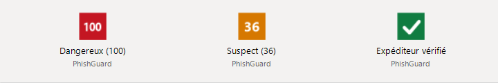
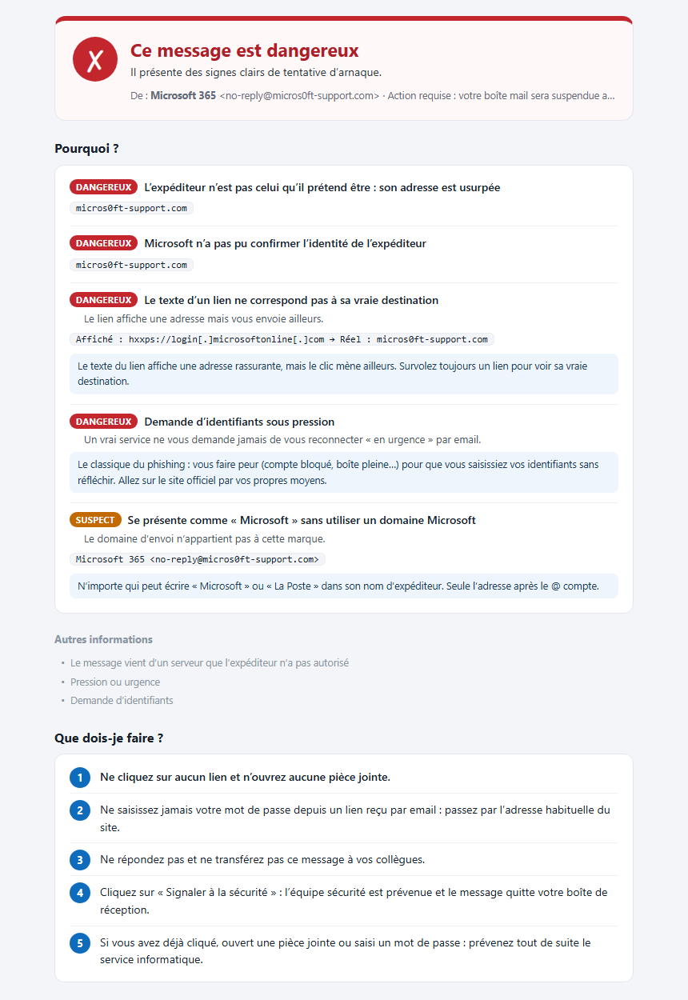
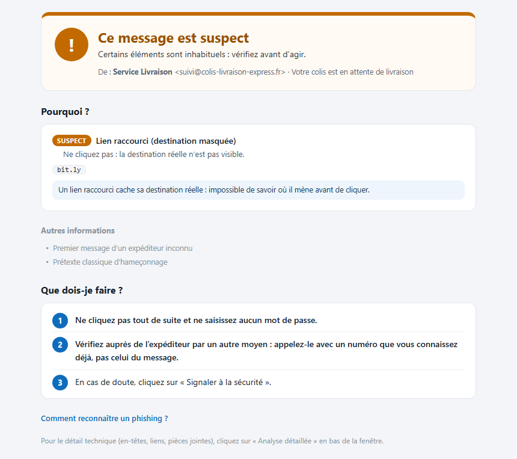
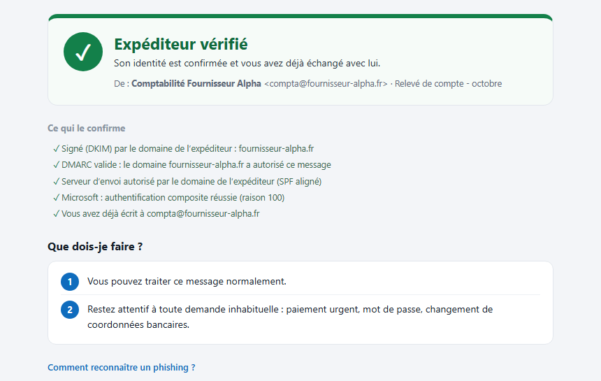
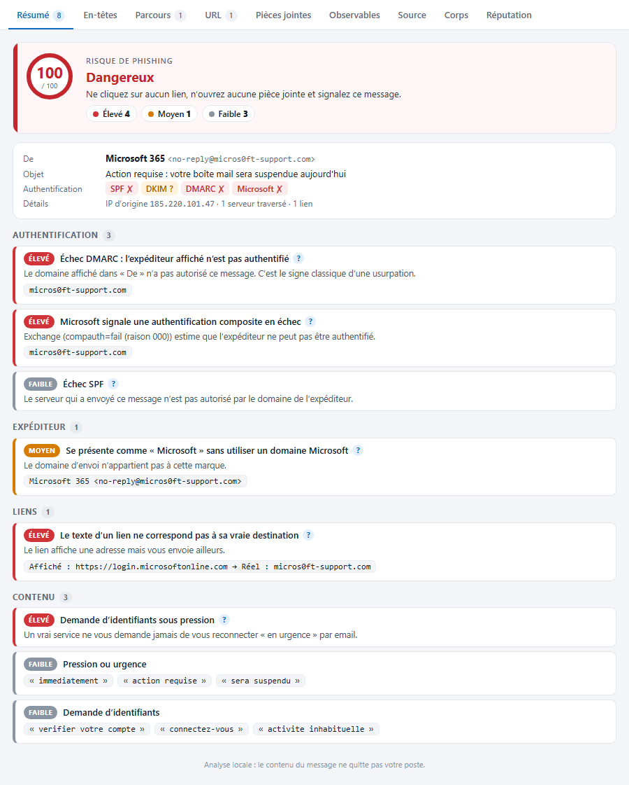
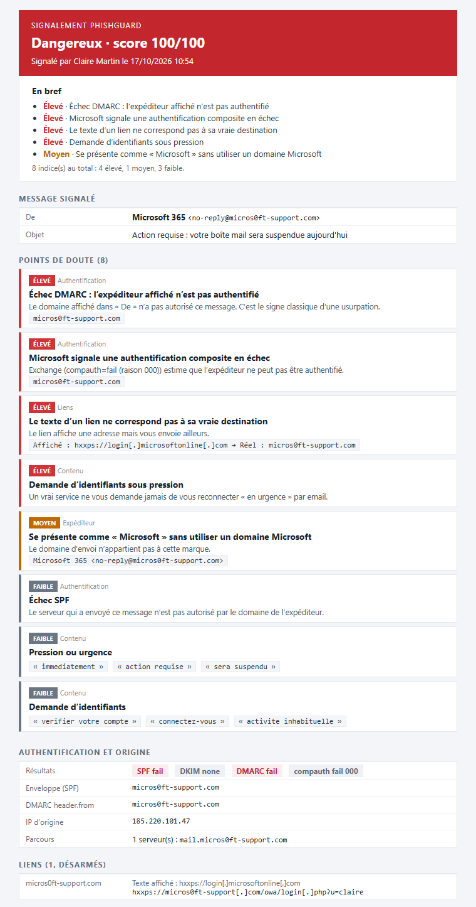
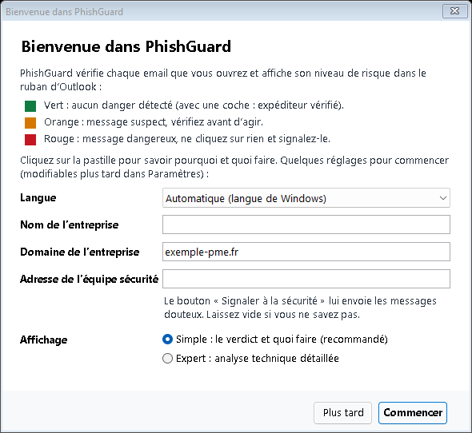
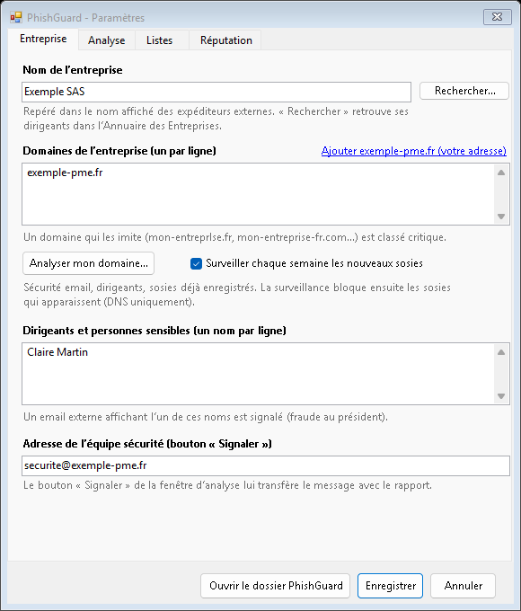
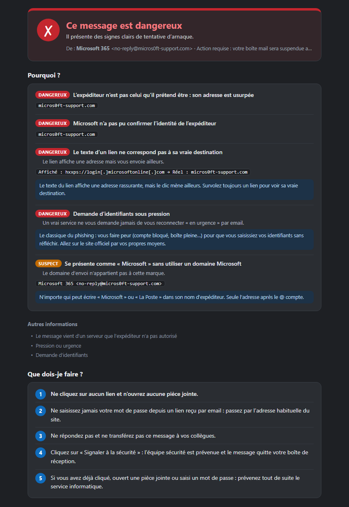
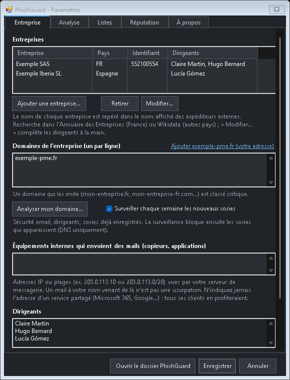

# PhishGuard : détecteur de phishing gratuit pour Outlook

[](../../releases/latest)
[](../../releases)
[](LICENSE)


**Repérez les emails de phishing (hameçonnage) avant de cliquer.** PhishGuard est un complément
**gratuit et open source pour Outlook classique sous Windows** (celui de Microsoft 365 Apps, Outlook 2019, 2021) qui analyse chaque email
**sur votre poste** et affiche un verdict clair dans le ruban : vert, orange ou rouge. Faux emails Microsoft,
usurpation d'identité, **fraude au président**, **faux RIB**, liens piégés, pièces jointes dangereuses,
**QR codes frauduleux** : il dit en clair **pourquoi** le message est dangereux et **quoi faire**.

<p align="center">
  
</p>

**[⬇ Télécharger PhishGuard pour Outlook](../../releases/latest)** · installation en un clic, sans droits administrateur.

- **Pour tout le monde** : un mode simple explique le verdict sans jargon, étape par étape. Un mode expert offre une analyse détaillée des en-têtes, du parcours du message, des liens et des pièces jointes.
- **Confidentiel** : le contenu des messages ne quitte jamais le poste. Aucune clé d'API nécessaire.
- **Pensé pour l'entreprise** : Exchange ou Microsoft 365, signalement en un clic à l'équipe sécurité, déploiement silencieux, configuration centralisée, interface en français et en anglais.

## Aperçu

| Message dangereux (mode simple) | Message suspect (mode simple) |
|---|---|
|  |  |

| Expéditeur vérifié | Analyse détaillée (mode expert) |
|---|---|
|  |  |

| Signalement envoyé à l'équipe sécurité | Assistant de démarrage | Paramètres |
|---|---|---|
|  |  |  |

| Thème sombre (suit Windows) | Paramètres en thème sombre |
|---|---|
|  |  |

*Captures générées automatiquement par le vrai moteur d'analyse, sur des messages d'exemple fictifs.*

> *English summary — PhishGuard is a **free, open-source phishing detector for Outlook** (classic Outlook
> for Windows, including the one in Microsoft 365 Apps; not the new Outlook or Outlook on the web). It analyzes every email locally (content never leaves the PC) and shows a
> clear verdict in the ribbon: spoofing, lookalike domains, CEO fraud, fake bank details, malicious links
> and attachments, QR code phishing (quishing), thread hijacking. A simple mode explains what to do; an
> expert mode offers a detailed investigation view (headers, message path, links, attachments), and one click sends a detailed HTML report to
> your security team. Interface in French and English.*

---

## Sommaire

- [Fonctionnalités](#fonctionnalités)
- [Installation](#installation)
- [Utilisation](#utilisation)
- [Configuration](#configuration)
- [Déploiement en entreprise](#déploiement-en-entreprise)
- [Confidentialité](#confidentialité)
- [Questions fréquentes](#questions-fréquentes)
- [Construire depuis les sources](#construire-depuis-les-sources)
- [Dépannage](#dépannage)
- [Limites connues](#limites-connues)
- [Licence et crédits](#licence-et-crédits)

---

## Fonctionnalités

### Dans Outlook

| | |
|---|---|
| **Score permanent** | Un seul bouton dans le ruban : il affiche le verdict et le score (pastille verte, orange ou rouge) du message sélectionné ou ouvert, sans clic. |
| **Alerte** | Une notification discrète en bas à droite de l'écran pour les messages dangereux (ou suspects, au choix). |
| **Mode simple** (par défaut) | Pour les non-spécialistes : le verdict en clair (« Ce message est dangereux »), chaque point dangereux ou suspect détaillé sans jargon (explication, preuves), les simples informations en gris, **« Que dois-je faire ? »** étape par étape et des conseils pour reconnaître un phishing. Un assistant au démarrage d'Outlook explique la pastille et demande l'essentiel ; après une mise à jour, il ne pose que les questions nouvelles. |
| **Mode expert** | Bouton **Analyse détaillée** (ou Paramètres → Affichage → Fenêtre d'analyse) : la fenêtre d'enquête complète ci-dessous, et les réglages avancés (Listes, Réputation, Analyser mon domaine). |
| **Fenêtre d'enquête** (mode expert) | Jauge de risque, indices classés par gravité, parcours des serveurs en frise ; onglets Résumé, En-têtes, Parcours, URL, Pièces jointes, Source, Réputation. Les boutons Signaler, Ce n'est pas du phishing et Paramètres sont en bas de cette fenêtre. |
| **Signaler** | Après une double confirmation, envoie à l'équipe sécurité un rapport HTML (verdict, points de doute détaillés, authentification et origine, liens désarmés, pièces jointes et empreintes, observables à copier, copie du texte du message) avec le message d'origine joint (.msg avec tous ses en-têtes), puis le déplace dans Courrier indésirable. |
| **Ce n'est pas du phishing** | Ajoute l'expéditeur ou son domaine aux expéditeurs de confiance (une usurpation reste toujours signalée). |
| **Explications pédagogiques** | Sous chaque indice, « pourquoi c'est dangereux » et quoi faire. Désactivables pour les utilisateurs expérimentés. |
| **Paramètres** | Tous les réglages depuis Outlook, sans éditer de fichier (onglets Entreprise, Analyse, Affichage, Listes, Réputation, À propos). Onglet Entreprise : **plusieurs entreprises** (groupe, filiales, y compris à l'étranger), retrouvées avec leurs dirigeants dans l'[Annuaire des Entreprises](https://annuaire-entreprises.data.gouv.fr/) pour la France ou dans [Wikidata](https://www.wikidata.org/) pour les autres pays (sans clé) ; une entreprise absente des annuaires (filiale étrangère, Monaco…) se saisit à la main avec ses dirigeants ; la liste des dirigeants surveillés en découle. Le domaine de votre adresse Outlook est proposé comme domaine de l'entreprise. |
| **Réputation** | Sources externes optionnelles : Red Flag Domains, domaines du secteur public, OpenPhish, Tranco, DNS (MX, SPF, politique DMARC, BIMI avec certificat VMC/CMC, domaine géré par les serveurs DNS d'une marque), crt.sh (sans clé) ; VirusTotal, abuse.ch, AbuseIPDB (clé gratuite). Résultats regroupés dans l'onglet Réputation de la fenêtre. Les clés sont rangées dans le Gestionnaire d'identification de Windows. |
| **Analyser mon domaine** | Depuis Paramètres → Entreprise : bilan de la sécurité email de votre domaine (MX, SPF, DKIM, DMARC, BIMI, MTA-STS, services autorisés à envoyer en votre nom), SIREN lu dans les mentions légales du site puis dirigeants, **sosies déjà enregistrés** (≈170 variantes vérifiées dans le DNS), certificats récents contenant votre marque et domaines liés (crt.sh). Les sosies cochés rejoignent la liste de blocage. |
| **Surveillance des sosies** | Chaque semaine, les variantes de vos domaines sont revérifiées : un sosie apparu depuis la dernière fois est bloqué automatiquement (et un nouveau certificat contenant votre marque, si crt.sh est activé). |
| **Expéditeur vérifié** | Pastille verte avec une coche quand le message est authentifié pour le domaine affiché (DMARC, DKIM aligné ou compauth Microsoft) **et** vient de quelqu'un avec qui vous êtes déjà en relation (correspondant connu, réponse à l'un de vos messages, expéditeur de confiance), sans aucun indice. Les preuves sont listées dans la fenêtre ; elles ne compensent jamais un indice Élevé ou Critique. |
| **Français / anglais** | Langue de l'interface au choix, ou automatique selon Windows. |
| **Thème clair ou sombre** | Les fenêtres suivent le mode clair ou sombre de Windows (Paramètres → Personnalisation → Couleurs), y compris quand il change pendant qu'Outlook est ouvert. Réglable aussi dans Paramètres → Affichage → Thème. Le rapport envoyé à l'équipe sécurité reste en clair. |

### Contrôles effectués

| Domaine | Contrôles |
|---|---|
| **Authentification** | SPF, DKIM, DMARC, compauth (Microsoft, avec ses codes de raison : 001 insuffisant, 002 interdit, 010/6xx usurpation interne, 1xx/130 réussite), y compris via `ARC-Authentication-Results` écrit par votre propre serveur. **Alignement** DKIM et SPF avec le domaine affiché. Usurpation de votre propre domaine. Envoi en nombre conforme (désabonnement en un clic + DMARC). |
| **Fil de discussion** | Réponse réelle à l'un de vos messages envoyés (Message-ID), et **détournement de fil** : une « réponse » qui vient d'une autre organisation que celle à qui vous aviez écrit. |
| **Expéditeur** | Domaines sosies de grandes marques, de **votre entreprise** et de **vos correspondants** (typosquatting, homoglyphes, caractères Unicode, marque + mots ajoutés, marque en sous-domaine). **Premier contact**. **Âge du domaine** (RDAP) ; l'onglet Réputation affiche l'âge de chaque domaine du message (expéditeur, réponse, liens) et le récupère d'un clic, quand vous le décidez (recherche automatique désactivée par défaut). Nom affiché trompeur, Reply-To détourné, usurpation d'un dirigeant (fraude au président), tenant `onmicrosoft.com`. |
| **Liens** | Sosies, texte du lien ≠ destination, **texte qui imite un fichier** (`C:\…`, `facture.pdf` qui télécharge un `.exe` ou un `.lnk`), **liens vers un fichier local ou un partage réseau** (`file:`, `\\serveur\…`), protocoles qui lancent Windows (`search-ms:`, `ms-msdt:`…) ou un document Office distant, liens réécrits par les passerelles (Proofpoint, Safe Links, Barracuda, Sophos, Trend Micro, Symantec, FortiMail) et redirections déballés, adresse IP, `@` dans l'URL, raccourcisseurs, hébergeurs gratuits détournés, extensions à risque, domaines récents, listes de blocage. Les liens contenus dans les PDF et pièces jointes HTML sont aussi analysés. |
| **Pièces jointes** | Extension, double extension, caractère d'inversion Unicode, **type réel** (programme renommé en `.pdf`…), empreintes MD5/SHA1/SHA256, et **contenu** : programme caché dans un ZIP, archive chiffrée, macros (y compris cachées dans un `.docx`), JavaScript dans un PDF, fausse page de connexion HTML, objet RTF. |
| **QR codes** | Les QR codes contenus dans les images du message (dans le corps ou en pièce jointe) sont **lus sur le poste** : leur présence est signalée (« quishing ») et l'adresse qu'ils contiennent est analysée comme un lien. |
| **Contenu** | Urgence, demande d'identifiants, demande financière, **IBAN** et changement de RIB, demande de discrétion, QR code, faux « RE: », formulaire dans le message. |
| **Filtres de messagerie** | Objet marqué « SPAM »/« PHISHING », SCL d'Exchange, SpamAssassin, Orange, FortiMail (au mieux). |
| **Listes de blocage** | [Red Flag Domains](https://red.flag.domains/) (nouveaux domaines .fr suspects, mise à jour quotidienne), liste de l'équipe sécurité (`custom.txt`), liste de l'utilisateur (onglet Listes), liste partagée sur le réseau, sosies détectés par la surveillance. |
| **Organismes publics et domaines des marques** | Les domaines `.gouv.fr` (réservés à l'État) et ceux de la [liste ouverte du secteur public](https://github.com/etalab/noms-de-domaine-organismes-secteur-public) de la DINUM (environ 100 000 : ministères, collectivités, hôpitaux, écoles…) ne sont jamais pris pour des sosies. Un domaine qui ressemble à une marque ou à votre entreprise (autre extension, ancien nom) est reconnu comme le sien lorsqu'il est géré par ses propres serveurs DNS (vérification DNS activée). |
| **Réputation** (optionnel) | OpenPhish, Tranco, DNS de l'expéditeur (existence, MX, SPF, politique DMARC, BIMI), âge du premier certificat (crt.sh), VirusTotal (empreintes des pièces jointes), URLhaus et ThreatFox (abuse.ch), AbuseIPDB (IP d'origine). |

### Fenêtre d'enquête

- **En-têtes** : champs principaux décodés, détail de l'authentification (domaines, sélecteur DKIM), en-têtes des filtres antispam, liens de vérification des domaines de l'expéditeur.
- **Parcours** : chaque serveur traversé, IP, protocole, horodatage et délai entre les sauts ; **IP d'origine**.
- **Liens de vérification** (domaines, IP, liens, empreintes) dans chaque onglet, sans compte à créer : VirusTotal, Cisco Talos, AbuseIPDB, listes noires (MXToolbox) et WHOIS (ouverts dans le navigateur, seul l'élément vérifié est transmis).
- **Réputation** : état de chaque source externe et résultats obtenus.

---

## Installation

**Prérequis** : Windows 10/11, **Outlook classique** (version de bureau de Microsoft 365 Apps, 2019, 2021…), .NET Framework 4.6 ou plus (présent par défaut). Le nouvel Outlook et Outlook sur le web ne sont pas pris en charge.

1. Téléchargez **`PhishGuard-Outlook-vX.Y.Z-installeur.exe`** dans [Releases](../../releases).
2. **Fermez Outlook**, lancez l'exe et cliquez sur **Installer** (aucun droit administrateur demandé).
3. Ouvrez Outlook : le score PhishGuard apparaît dans l'onglet Accueil. Les réglages (domaines de l'entreprise,
   adresse de signalement, langue…) se font depuis Outlook : cliquez sur le score, puis **Paramètres**.

L'exe n'est pas signé : Windows peut afficher « Windows a protégé votre ordinateur » → *Informations
complémentaires* → *Exécuter quand même*. Si votre antivirus ou AppLocker bloque l'exe, prenez le zip
`PhishGuard-Outlook-vX.Y.Z.zip`, décompressez-le et lancez `installer.cmd` (même installation, en script).
Pour imposer des valeurs par défaut à toute l'entreprise, modifiez `config.ini` dans le zip avant de l'installer.

**Désinstaller** : Paramètres Windows → Applications → *PhishGuard pour Outlook*, ou `%LOCALAPPDATA%\PhishGuard\desinstaller.cmd`.

---

## Utilisation

1. **Sélectionnez un email** : le bouton PhishGuard affiche par exemple « Dangereux (85) ». Survolez-le pour voir les principaux indices.
2. **Cliquez dessus** : en mode simple, la fenêtre dit pourquoi et quoi faire ; **Analyse détaillée** ouvre la fenêtre d'enquête complète.
3. En bas de la fenêtre : **Signaler à la sécurité** envoie le message et un rapport détaillé à l'équipe sécurité (après double confirmation), **Ce n'est pas du phishing** corrige un faux positif, **Paramètres** ouvre les réglages.

Niveaux : **Risque faible** (0–19), **Suspect** (20–49), **Dangereux** (50 et plus, ou au moins un indice critique).
**Expéditeur vérifié** remplace « Risque faible » quand l'expéditeur est authentifié, déjà en relation avec vous et qu'aucun indice n'a été relevé.

---

## Configuration

Depuis Outlook : cliquez sur le score PhishGuard, puis sur **Paramètres** en bas de la fenêtre d'analyse
(sans email sélectionné, un clic sur le bouton propose aussi d'ouvrir les paramètres). Les réglages sont enregistrés pour chaque
utilisateur dans `%LOCALAPPDATA%\PhishGuard\config.user.ini` et survivent aux réinstallations.

Le fichier `config.ini` fourni avec l'installeur définit les valeurs par défaut :

| Clé | Rôle | Défaut |
|---|---|---|
| `Company1`, `Company2`… | Entreprises surveillées : `Nom \| Pays \| Identifiant \| Dirigeant; Dirigeant` (leurs noms et dirigeants servent à détecter l'usurpation et la fraude au président) | — |
| `CompanyName`, `CompanyDomains` | Nom principal (anciennes versions) et domaines de l'entreprise ; leurs sosies sont classés critiques | — (domaines : celui de l'adresse Outlook de l'utilisateur, hors messageries gratuites) |
| `VipNames` | Dirigeants (anciennes versions : repris dans la première entreprise) | — |
| `ReportAddress` | Adresse de l'équipe sécurité pour **Signaler** | — |
| `Language` | `auto` (langue de Windows), `fr` ou `en` | `auto` |
| `Theme` | `auto` (mode clair ou sombre de Windows), `light` ou `dark` | `auto` |
| `TrustedDomains`, `TrustedSenders` | Domaines et adresses de confiance | — |
| `AutoAnalyze` | Score automatique du message sélectionné | `true` |
| `AlertLevel` | `dangerous`, `suspicious` ou `none` | `dangerous` |
| `AutoHashMaxMB` | Taille max. des pièces jointes analysées automatiquement | `5` |
| `ShowExplanations` | Explications pédagogiques | `true` |
| `CheckUpdates` | Une fois par jour, demande à GitHub le numéro de la dernière version et prévient (À propos, barre d'état). Rien n'est téléchargé ni installé | `true` |
| `KnownCorrespondents` | Premier contact et sosies de correspondants | `true` |
| `DomainAgeAuto` | Âge des domaines recherché automatiquement (RDAP) ; sinon d'un clic dans l'onglet Réputation. `DomainAgeLookup` reste accepté dans `config.ini` et les stratégies | `false` |
| `TagCategory` | Catégorie de couleur dans la boîte de réception | `false` |
| `MoveAfterReport` | Déplacer en Courrier indésirable après signalement | `true` |
| `ScoreLog` | Journal des scores (`scores.csv`) | `true` |
| `SharedBlocklistPath` | Liste de blocage partagée (ex. `\\serveur\securite\phishguard.txt`) | — |
| `RedFlagEnabled`, `RedFlagUrl`, `RedFlagMaxAgeHours` | Liste Red Flag Domains, son adresse, âge maximal avant mise à jour | `true`, liste officielle, `24` |
| `WatchDomains` | Surveillance hebdomadaire des sosies de `CompanyDomains` | `true` |
| `InternalRelays` | IP, plages CIDR ou noms des équipements qui envoient au nom de l'entreprise (alertes, copieurs, applications) | vide |
| `MailServers` | IP, plages CIDR ou noms des serveurs de messagerie internes (Exchange, passerelle, relais) | vide |
| `WorkstationNets` | Plages CIDR des réseaux des postes de travail : un message au nom de l'entreprise parti directement d'un poste est critique | vide |
| `PublicSectorList` | Liste des domaines du secteur public (DINUM), téléchargée chaque mois | `true` |
| `BetaOpenPhish`, `BetaTranco`, `BetaDnsChecks`, `BetaCertAge` | Sources de réputation sans clé (onglet Réputation) | `false` |
| `VirusTotalKey`, `AbuseChKey`, `AbuseIpdbKey` | Clés par défaut pour tous ; un utilisateur peut saisir les siennes, rangées dans le Gestionnaire d'identification de Windows et prioritaires | — |
| `ExpertMode` | `false` : fenêtre simple (débutants) ; `true` : analyse détaillée et réglages avancés | `false` |

Une clé d'API écrite dans `config.ini` y est lisible en clair : préférez la saisie par chaque utilisateur.

---

## Déploiement en entreprise

- **Installation silencieuse** (script de connexion, GPO, outil de déploiement) : `PhishGuard-Outlook-vX.Y.Z-installeur.exe /quiet` ou `installer.cmd /quiet`.
- **Réglages imposés par GPO ou Intune** : modèle de stratégies `policies\PhishGuard.admx` (français et anglais) fourni dans le zip de chaque release. Adresse de l'équipe sécurité, entreprises et domaines, **mode simple imposé** pour certains groupes, clés d'API interdites, sources activées… L'utilisateur ne peut pas les modifier. Guide complet : [docs/deploiement-entreprise.md](docs/deploiement-entreprise.md).
- **Phishing fabriqué en interne** : déclarez vos serveurs de messagerie (`MailServers`) et les réseaux des postes (`WorkstationNets`) ; un message au nom de l'entreprise déposé directement au serveur depuis un poste, sans authentification, est signalé comme critique avec l'adresse du poste.
- **Copieurs et applications internes** : déclarez leurs adresses IP (`InternalRelays`) pour que leurs mails envoyés au nom de l'entreprise ne soient pas pris pour une usurpation ; un mail à votre nom venant d'ailleurs reste critique.
- **Configuration de départ** : `config.ini` fournit les valeurs initiales, que chaque utilisateur peut ensuite modifier (sauf celles imposées par stratégie).
- **Liste de blocage commune** : un fichier texte sur un partage réseau (`SharedBlocklistPath`), rechargé toutes les heures.
- **Signature** : signer `PhishGuard.dll` avec le certificat de signature de code de l'entreprise évite les blocages par l'antivirus, AppLocker ou la stratégie « compléments signés uniquement ».
- **Postes verrouillés** : rien n'est compilé sur le poste ; si l'exe est bloqué, le zip de la release s'installe avec `installer.cmd`.

---

## Confidentialité

| Donnée | Où elle va |
|---|---|
| Contenu, objet, pièces jointes des messages | **Nulle part** : analyse sur le poste |
| Noms de domaine (âge du domaine) | `rdap.org` puis le registre du domaine (désactivable) |
| Liste Red Flag Domains | Téléchargée depuis `dl.red.flag.domains` (aucune donnée envoyée) |
| Liste du secteur public | Téléchargée chaque mois depuis `raw.githubusercontent.com` (aucune donnée envoyée) |
| Nom d'une entreprise recherchée (bouton « Ajouter une entreprise ») | `recherche-entreprises.api.gouv.fr` (France) ou `wikidata.org` (autres pays), uniquement au clic |
| Vos domaines et leurs variantes (analyse et surveillance des sosies) | Serveur DNS de votre entreprise ; `crt.sh` pour les certificats ; votre propre site pour les mentions légales |
| Sources de réputation (si activées) | OpenPhish et Tranco : listes téléchargées, comparaison sur le poste. DNS : serveur DNS de l'entreprise. crt.sh, abuse.ch : noms de domaine. VirusTotal, abuse.ch : empreintes SHA-256 des pièces jointes (jamais le fichier). AbuseIPDB : IP d'origine |
| Signalement | Le message et le rapport sont envoyés à l'adresse de l'équipe sécurité configurée, et à elle seule |
| Liens de vérification (VirusTotal…) | Uniquement si vous cliquez, et seulement l'élément vérifié |

Fichiers créés dans `%LOCALAPPDATA%\PhishGuard` : réglages (`config.user.ini`, `custom.user.txt`), correspondants (`correspondants.txt`),
identifiants techniques de vos messages envoyés et domaines de leurs destinataires (`fils.txt`, sans objet ni contenu),
sosies surveillés (`surveillance.txt`), âge des domaines déjà vérifiés, listes Red Flag Domains, secteur public, OpenPhish et Tranco,
journal des scores (`scores.csv`, sans objet ni contenu), journal technique (`phishguard.log`).
Les clés d'API ne sont pas dans ce dossier : elles sont dans le Gestionnaire d'identification de Windows (« PhishGuard:… »).

---

## Questions fréquentes

**Comment savoir si un email est un phishing ?**
Regardez l'adresse réelle de l'expéditeur (pas seulement son nom), survolez les liens avant de cliquer, méfiez-vous
de l'urgence et de toute demande de mot de passe, de paiement ou de changement de RIB. PhishGuard fait ces
vérifications à votre place, et bien d'autres (SPF, DKIM, DMARC, domaines sosies, pièces jointes, QR codes…),
puis affiche un verdict clair.

**Comment signaler un email de phishing dans Outlook ?**
Cliquez sur la pastille PhishGuard, puis sur **Signaler à la sécurité** : après confirmation, le message et un
rapport détaillé partent à l'adresse de votre équipe sécurité, et le message est déplacé dans Courrier indésirable.

**PhishGuard détecte-t-il vraiment les phishings ?**
Le moteur est testé sur de vrais emails publics : hors ligne, il signale **78 à 80 % des phishings** de deux corpus
totalisant plus de 14 000 attaques réelles (2020-2026), avec **3 % de fausses alertes** sur 4 400 messages légitimes récents et
aucune sur 40 vrais-faux pièges (factures, colis, codes de vérification, partages DocuSign ou OneDrive…). Sur un vrai
poste, l'âge des domaines et les listes de sites malveillants en détectent davantage. Méthode et chiffres :
[docs/banc-essai.md](docs/banc-essai.md).

**PhishGuard est-il gratuit ?**
Oui, gratuit et open source (GPL v3), sans abonnement ni clé d'API. Les sources de réputation qui demandent une
clé (VirusTotal, abuse.ch, AbuseIPDB) sont facultatives et proposent des clés gratuites.

**Mes emails sont-ils envoyés à un service extérieur ?**
Non. L'analyse se fait sur votre ordinateur. Seuls des noms de domaine, des empreintes de fichiers ou une adresse
IP peuvent être vérifiés en ligne, et seulement si vous activez ces sources (voir [Confidentialité](#confidentialité)).

**Est-ce que ça marche avec le nouvel Outlook, Outlook sur le web ou Gmail ?**
PhishGuard fonctionne avec **Outlook classique pour Windows** : la version de bureau fournie avec Microsoft 365 Apps,
ou Outlook 2019 et 2021. Votre boîte peut être sur Exchange, Exchange Online (Microsoft 365) ou un autre fournisseur
(Orange, Gmail…) relevé dans Outlook. Le **nouvel Outlook** et Outlook sur le web n'acceptent plus les compléments COM.
Microsoft prévoit de rendre le nouvel Outlook par défaut en entreprise à partir de mars 2027 (avec possibilité de revenir
à la version classique), et maintient Outlook classique au moins jusqu'en 2029.

**Faut-il être administrateur pour l'installer ?**
Non : l'installation se fait dans le profil de l'utilisateur. Les entreprises peuvent la déployer en silence
(`/quiet`) et imposer une configuration commune.

**PhishGuard remplace-t-il un antivirus ou une passerelle de messagerie ?**
Non, il les complète : il analyse ce qui arrive malgré tout dans la boîte de réception et aide chacun à décider,
au moment où il lit le message.

---

## Construire depuis les sources

Aucune installation nécessaire : le compilateur C# fourni avec Windows (.NET Framework 4) suffit.

```bat
cd outlook-exe
construire.bat
```

Le script compile et lance les tests du moteur, compile `PhishGuard.dll`, prépare `build\package\`
(installation) et crée l'installeur `build\PhishGuard-Outlook.exe` (fichiers intégrés à l'exe).

L'intégration continue ([`.github/workflows/build.yml`](.github/workflows/build.yml)) fait la même chose
sur un serveur Windows de GitHub à chaque modification, et publie une release (installeur, zip, empreintes SHA-256)
pour chaque tag `v*` ou lancement manuel avec un numéro de version. Les erreurs de compilation et les tests
en échec apparaissent dans les annotations du job.

### Structure du dépôt

```
outlook-exe/                  Complément Outlook (COM, C# 5, .NET Framework 4)
  src/Engine/                 Moteur d'analyse (sans dépendance à Outlook, testable)
  src/AddIn/                  Ruban, lecture des messages, fenêtres, tâches de fond
  tests/Tests.cs              Tests du moteur (lancés à chaque construction)
  tests/legitimes/            Mails légitimes « difficiles » du banc d'essai (générés par tools/gen-legitimes.py)
  installer/                  Installeur .exe (Setup.cs) et scripts installer.cmd / desinstaller.cmd
  src/ThirdParty/ZXing/       Décodeur QR de ZXing.Net (Apache 2.0, non modifié sauf syntaxe C# 5)
  config.ini, custom.txt      Configuration par défaut et liste de blocage de l'équipe sécurité
  policies/                   Modèle de stratégies de groupe (ADMX/ADML, généré par tools/gen-admx.py)
  LISEZMOI.md                 Notice incluse dans le zip de la release
  tools/Screenshots.cs        Génère les captures d'écran du README (workflow « Captures d'écran »)
  tools/Bench.cs              Banc d'essai sur des corpus publics (workflow « Banc d'essai », voir docs/banc-essai.md)
docs/                         Notes de version, banc d'essai, captures d'écran
.github/workflows/            Construction, tests, releases, captures d'écran, banc d'essai
```

---

## Dépannage

| Symptôme | Solution |
|---|---|
| Le groupe PhishGuard n'apparaît pas | Outlook → Fichier → Options → Compléments → *Gérer : Compléments COM* → **Atteindre** : cocher PhishGuard ; vérifier aussi *Éléments désactivés*. |
| PhishGuard est décoché à chaque démarrage | Une stratégie de groupe limite les compléments ou exige qu'ils soient signés. |
| « Windows a protégé votre ordinateur » | Exe non signé : *Informations complémentaires* → *Exécuter quand même*, ou installation par le zip. |
| « Liste Red Flag Domains non chargée » | Le proxy bloque `dl.red.flag.domains` ; l'analyse fonctionne sans la liste. |
| Une source de l'onglet Réputation reste « injoignable » | Le proxy bloque le service, ou la clé est refusée ; l'analyse locale continue. |
| Le signalement s'ouvre au lieu de partir | Outlook a refusé l'envoi automatique (stratégie, mode hors connexion) : cliquez sur Envoyer. |
| « Windows refuse de lancer le compilateur » (`construire.bat`) | Compilateur bloqué sur ce poste : utilisez la release déjà compilée. |

Journal technique : `%LOCALAPPDATA%\PhishGuard\phishguard.log`.

---

## Limites connues

- Fonctionne avec **Outlook classique pour Windows** uniquement (pas le nouvel Outlook ni Outlook sur le web, qui n'acceptent pas les compléments COM).
- Les liens contenus dans des flux PDF compressés ne sont pas extraits.
- Mimecast et Cisco réécrivent les liens sous une forme chiffrée : leur vraie destination ne peut pas être lue.
- La recherche de certificats contenant votre marque (crt.sh) est lente et peut expirer ; le reste de l'analyse du domaine n'en dépend pas.
- La détection FortiMail repose sur des noms d'en-têtes génériques ; les contributions avec des exemples réels sont bienvenues.
- Aucun outil ne détecte 100 % des attaques : PhishGuard aide à décider, il ne remplace pas la vigilance. Le [banc d'essai](docs/banc-essai.md) donne les taux mesurés.

---

## Licence et crédits

Code publié sous licence **GNU GPL v3** (voir [LICENSE](LICENSE)) : vous pouvez l'utiliser, le modifier et le redistribuer, à condition que les versions modifiées restent sous la même licence et que leur code source soit fourni.

- Liste [Red Flag Domains](https://red.flag.domains/) : données sous licence **CC BY-NC-SA 4.0** (usage non commercial). Elle est téléchargée par chaque poste et n'est pas redistribuée ici. Pour un usage en entreprise, vérifiez que votre cas est couvert (hello@red.flag.domains) ou désactivez-la (`RedFlagEnabled = false`).
- Âge des domaines : service public [rdap.org](https://rdap.org/) et registres RDAP.
- Domaines du secteur public : [liste de la DINUM](https://github.com/etalab/noms-de-domaine-organismes-secteur-public) (Licence Ouverte 2.0), téléchargée par chaque poste.
- Dirigeants : [Annuaire des Entreprises](https://annuaire-entreprises.data.gouv.fr/) (données INSEE et RNE) et [Wikidata](https://www.wikidata.org/) (données sous licence CC0).
- Sources de réputation optionnelles : [OpenPhish](https://openphish.com/) (flux communautaire, usage non commercial), [Tranco](https://tranco-list.eu/), [crt.sh](https://crt.sh/), [VirusTotal](https://www.virustotal.com/), [abuse.ch](https://abuse.ch/), [AbuseIPDB](https://www.abuseipdb.com/), chacune selon ses propres conditions d'utilisation.
- Lecture des QR codes : décodeur de [ZXing.Net](https://github.com/micjahn/ZXing.Net) (licence Apache 2.0, voir `outlook-exe/src/ThirdParty/ZXing/LICENSE`).
- Inspiré par [PhishTool](https://www.phishtool.com/). PhishGuard n'est ni affilié à PhishTool ni approuvé par lui ; PhishTool est une marque de son propriétaire.
